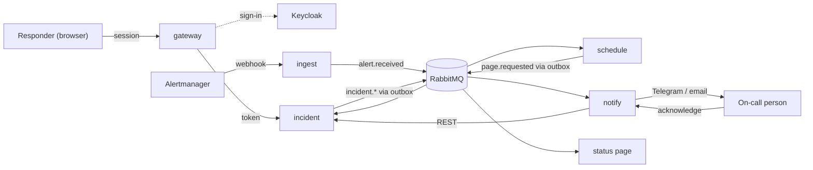

# PageRewind

[](https://github.com/Yohan-Senadheera/pagerewind/actions/workflows/java-ci.yml)
[](https://github.com/Yohan-Senadheera/pagerewind/actions/workflows/e2e.yml)
[](https://github.com/Yohan-Senadheera/pagerewind/actions/workflows/terraform-ci.yml)
[](LICENSE)

**On-call that pages you, then rewinds what your pods did before they died.**

PageRewind is an open-source, self-hosted on-call and incident tool for Kubernetes teams. An alert
comes in, duplicates become one incident, the person on call is paged on Telegram or email, and if
nobody acknowledges, the page escalates to the next person.

**Live demo:** [status.pagerewind.dev](https://status.pagerewind.dev) (the public status page of the reference
deployment on AWS; the cluster may be stopped between demos to save cost).

> **Status: preview.** Alert intake, incidents, on-call schedules, escalation, paging and the status
> page work and are tested end to end. The `main` branch adds logins with Keycloak, roles and the
> `gateway` (coming in v0.2.0); the released v0.1.0 and the live demo have no login yet. The flight
> recorder and "what changed" features are planned.

## Try it in 5 minutes

Needs Docker with Compose and about 4 GB of free memory.

```bash
git clone https://github.com/Yohan-Senadheera/pagerewind.git && cd pagerewind
cp .env.example .env            # then replace every "change-me" (openssl rand -hex 24)
docker compose up -d
./scripts/seed-demo.sh          # logins alice, bob, vera; Alice is on call, Bob is paged after 1 minute
./scripts/send-test-alert.sh    # send it several times: still one incident
```

Then open:

| What | Where |
|---|---|
| Incidents and who is on call (sign in as `alice` or `bob`, responders, or `vera`, viewer; password `DEMO_PASSWORD` from `.env`) | http://localhost:8080 |
| Pages sent by email (open one, use its acknowledge link) | http://localhost:8025 |
| Public status page | http://localhost:8085 |
| Keycloak admin console (user `admin`, `KEYCLOAK_ADMIN_PASSWORD`) | http://localhost:8180 |
| API docs | http://localhost:8082/swagger-ui.html |

Wait a minute without acknowledging and Bob gets paged too. Acknowledge from the email link and the
escalation stops. Sign in as `vera` and the Acknowledge and Resolve buttons are gone.
`./scripts/send-test-alert.sh resolved` sends the "resolved" signal.

The APIs need a Keycloak access token. Scripts use the `pagerewind-automation` client:

```bash
TOKEN=$(curl -s http://localhost:8180/realms/pagerewind/protocol/openid-connect/token   -d grant_type=client_credentials -d client_id=pagerewind-automation   -d client_secret="$(grep ^AUTOMATION_CLIENT_SECRET= .env | cut -d= -f2)" | jq -r .access_token)
curl -H "Authorization: Bearer $TOKEN" http://localhost:8080/api/v1/incidents
```

## What works today

| Area | What it does |
|---|---|
| **Alert intake** | Alertmanager webhook and a generic JSON webhook; bearer token or HMAC-SHA256 signature; answers `202` only after the message broker has stored the alert, `503` otherwise so the sender retries |
| **Incidents** | Duplicate alerts become one incident (enforced by a database index, safe under concurrency); `triggered → acknowledged → resolved` with optimistic locking; timeline and notes; REST API with OpenAPI |
| **On-call** | Teams, rotations and overrides; handovers keep local time across daylight saving changes; escalation policies with repeat |
| **Escalation** | Timers are database rows, so restarts never lose or repeat a page; several replicas share the work safely |
| **Paging** | Telegram with Acknowledge and Resolve buttons; email with signed, single-use, 30-minute links; retries with backoff and jitter; rate limits |
| **Status page** | Public page per service (operational, degraded, major outage) that never shows alert text |
| **Reliability** | Transactional outbox and idempotent consumers; poison messages go to a dead-letter queue after 5 attempts |
| **Logins and roles** (`main`) | Keycloak sign-in at the gateway (code flow with PKCE, tokens never reach the browser); roles viewer, responder and admin on every API; CSRF checks on forms; services call each other with their own client-credentials tokens; per-client rate limits on public webhooks |
| **Operations** | Health probes, Prometheus metrics, JSON logs in every service |

## How it works



| Service | Job |
|---|---|
| `gateway` | Signs people in with Keycloak, forwards their token to the pages and APIs, checks CSRF, rate-limits webhooks |
| `ingest` | Receives alerts, checks the token or signature, marks repeats, publishes with broker confirms |
| `incident` | Incident life cycle, timeline, REST API and web UI |
| `schedule` | People, teams, rotations, escalation policies and durable escalation timers |
| `notify` | Telegram and email pages; acknowledge and resolve from the page |
| `status` | Public status page built from incident events |

Java 21, Spring Boot 4.1 (gateway: Spring Cloud Gateway on Boot 4.2), Keycloak, PostgreSQL (one schema
per service, Flyway), RabbitMQ (quorum queues), Redis. More diagrams in [docs/architecture.md](docs/architecture.md); design decisions in
[docs/adr/](docs/adr/).

## How it is tested

Every pull request runs:

- **Unit and integration tests** (about 225) against real PostgreSQL, RabbitMQ, Redis, Mailpit and
  Keycloak in containers (Testcontainers), including concurrency tests: 100 copies of one alert make
  exactly one incident; parallel escalation runners page each step once; a publisher that dies mid-batch
  loses nothing. Security tests: no token, an expired, forged or wrong-audience token gets 401; a viewer
  gets 403; the gateway logs in through the real Keycloak login page with the realm file from this repo.
- **An end-to-end test** that builds the images, starts this quickstart and walks the whole flow:
  alert, incident, page, escalation, acknowledge by email link, status page, then signs in through
  Keycloak as a viewer (refused) and as a responder (resolves from the web page).
- **Terraform checks** for the reference deployment.

## Verified on the live cluster

On the reference deployment, a real alert pages the on-call engineer on Telegram within seconds,
escalates to the backup engineer after 2 minutes without acknowledgement, and stops when someone taps
**Acknowledge** on their phone. With the `schedule` pod deleted between the two steps, the second page
still arrived exactly on time, because escalation timers live in PostgreSQL, not in memory.

## Reference deployment

The project also runs on a two-node k3s cluster on AWS, built with Terraform and managed with Argo CD
(GitOps) and cert-manager (Let's Encrypt). CI holds no AWS credentials. To save cost, an EventBridge Scheduler job stops
both nodes every night at 02:00 (Asia/Colombo). See [infra/](infra/),
[platform/](platform/) and `scripts/pagerewind.ps1`.

## Roadmap

| Version | Planned |
|---|---|
| v0.2.0 | Done on `main`: login with Keycloak, roles, tokens between services, `gateway`. Still to do: Keycloak on the reference cluster, mTLS between services, secrets from AWS Secrets Manager, Kyverno policies |
| v0.3.0 | Helm chart; signed images with SBOM; SLO dashboards and alerts |
| v0.4.0 | **Flight recorder** (recent logs and events frozen into the incident) and **what changed** (deploys and config changes before the alert, with a likely cause) |

## License

[Apache License 2.0](LICENSE)
