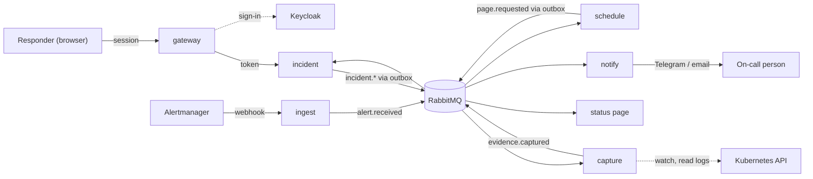

# PageRewind

[](https://github.com/Yohan-Senadheera/pagerewind/actions/workflows/java-ci.yml)
[](https://github.com/Yohan-Senadheera/pagerewind/actions/workflows/e2e.yml)
[](https://github.com/Yohan-Senadheera/pagerewind/actions/workflows/chart.yml)
[](https://github.com/Yohan-Senadheera/pagerewind/actions/workflows/images.yml)
[](LICENSE)

**On-call that pages you, then rewinds what your pods did before they died.**

PageRewind is an open-source, self-hosted on-call and incident tool for Kubernetes teams. An alert
comes in, duplicates become one incident, the person on call is paged on Telegram or email, and if
nobody acknowledges, the page escalates. Its **flight recorder** attaches the last logs of the failing
workload (even of pods that already crashed and were deleted) and the recent changes, with the most
likely cause, to the incident.

**Demo:** [3-minute video](https://youtu.be/7NzK9PC7FjE) of a page, a crash and the evidence it keeps.

**Live:** [status.pagerewind.dev](https://status.pagerewind.dev), the public status page of the reference
deployment on AWS. It runs only during demo sessions, to keep costs down.

## Try it

**Kubernetes (Helm)**: everything bundled, works on an empty kind cluster.
See [charts/pagerewind/README.md](charts/pagerewind/README.md).

```bash
helm install pagerewind charts/pagerewind -n pagerewind --create-namespace
```

**Docker Compose** (no flight recorder: it needs Kubernetes), about 4 GB of free memory:

```bash
git clone https://github.com/Yohan-Senadheera/pagerewind.git && cd pagerewind
cp .env.example .env            # then replace every "change-me" (openssl rand -hex 24)
docker compose up -d
./scripts/seed-demo.sh          # logins alice, bob, vera; Alice is on call, Bob is paged after 1 minute
./scripts/send-test-alert.sh    # send it several times: still one incident
```

| What | Where |
|---|---|
| Incidents and who is on call (`alice`/`bob` responders, `vera` viewer; password `DEMO_PASSWORD` from `.env`) | http://localhost:8080 |
| Pages sent by email (open one, use its acknowledge link) | http://localhost:8025 |
| Public status page | http://localhost:8085 |
| Keycloak admin console (user `admin`, `KEYCLOAK_ADMIN_PASSWORD`) | http://localhost:8180 |

## What it does

| Area | What it does |
|---|---|
| **Alert intake** | Alertmanager and generic JSON webhooks; bearer token or HMAC-SHA256 signature; `202` only after the broker has stored the alert, `503` otherwise so the sender retries |
| **Incidents** | Duplicate alerts become one incident (database-enforced, safe under concurrency); acknowledge and resolve with optimistic locking; timeline, notes, repeat occurrences with exact times |
| **On-call** | Teams, rotations, overrides; escalation policies with repeat; timers in the database, so restarts never lose or repeat a page |
| **Paging** | Telegram with Acknowledge and Resolve buttons; email with signed single-use links; retries with backoff |
| **Flight recorder** | Opted-in namespaces (`pagerewind.dev/record=true`): last 15 minutes of logs per container (secrets masked, memory-capped), lines of crashed and deleted pods kept 30 minutes, image and config changes recorded; on a new incident, an evidence bundle (zip) and a likely cause that tells reverts, rollbacks and re-deploys apart. Read-only access, no Secrets |
| **Status page** | Public, per service, with the incidents of the last 14 days; never shows alert text |
| **Logins and roles** | Keycloak sign-in at the gateway (PKCE, tokens never reach the browser); viewer, responder, admin on every API; services call each other with their own tokens |
| **Reliability** | Transactional outbox, idempotent consumers, dead-letter queues; health probes, Prometheus metrics, JSON logs |

## How it works



| Service | Job |
|---|---|
| `gateway` | Signs people in, forwards their token, checks CSRF, rate-limits webhooks |
| `ingest` | Receives alerts, checks the token or signature, publishes with broker confirms |
| `incident` | Incident life cycle, timeline, evidence, REST API and web UI |
| `schedule` | People, teams, rotations, escalation policies, durable timers |
| `notify` | Telegram and email pages; acknowledge and resolve from the page |
| `status` | Public status page |
| `capture` | Flight recorder and "what changed" |

Java 21, Spring Boot 4, Keycloak, PostgreSQL (one schema per service), RabbitMQ (quorum queues),
Redis. Architecture: [docs/architecture.md](docs/architecture.md); decisions: [docs/adr/](docs/adr/). Docs site: https://yohan-senadheera.github.io/pagerewind/

## How it is tested

- **Every pull request:** 235 unit and integration test methods against real PostgreSQL, RabbitMQ, Redis,
  Mailpit, Keycloak and a k3s cluster in containers (Testcontainers), including concurrency and security
  tests; an end-to-end run of the Compose quickstart; the Helm chart installed on a fresh kind cluster
  with a smoke test; secret scanning (gitleaks); Terraform checks.
- **Every image** is scanned with Trivy (fixable HIGH or CRITICAL fails the build), signed keylessly
  with cosign and given a signed SBOM. [Verify an image](charts/pagerewind/README.md#verify-the-images).

## Proven on the reference deployment

The reference deployment runs on two k3s nodes on AWS, built with Terraform and run by Argo CD (GitOps),
with Keycloak, Kyverno, External Secrets, an Istio ambient mesh (mTLS), Prometheus and Argo Rollouts.
What was checked on it, with write-ups:

| Check | Result |
|---|---|
| Page and escalation | Telegram page in seconds; escalation after 2 minutes; scheduler pod deleted mid-escalation, page still on time |
| Flight recorder | A crashed, deleted pod's last log lines in the incident; a bad deploy named as the likely cause |
| Supply chain | Only images signed by this repository's CI may run: an unsigned image is refused at admission |
| SLO alerting | Email deliveries failing: burn-rate alert, PageRewind opened an incident about itself and paged on Telegram |
| Canary release | A release with 50% injected errors was rolled back automatically after one 30-second measurement |
| Backups | pg_dump to S3 every 6 hours; restore test into a throw-away database matched row counts |
| Failure drills | Database unreachable, node failure, Keycloak down: [docs/postmortems/](docs/postmortems/) |

Runbooks: [docs/runbooks/](docs/runbooks/). Platform: [platform/](platform/), [deploy/](deploy/),
[infra/](infra/).

## Limitations

- The bundled data stores in the Helm chart are single instances for trying it out; production should use
  managed or operator-run PostgreSQL, RabbitMQ and Keycloak.
- The flight recorder keeps its buffer in memory: one replica, and buffered lines are lost if it restarts.
- Canary releases are set up for the `status` service only in the reference deployment.

## License

[Apache License 2.0](LICENSE)
