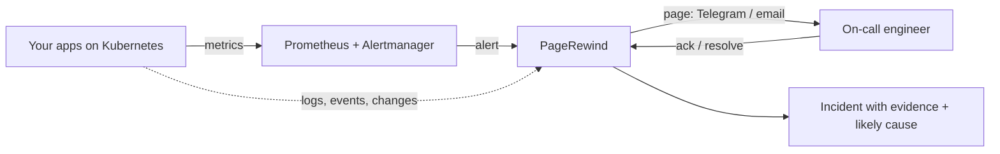

# PageRewind

**On-call that pages you, then rewinds what your pods did before they died.**

PageRewind is an open-source, self-hosted on-call and incident tool for Kubernetes teams. When an alert
fires, it pages the right person and attaches the answer: the logs from before the pod died and a
timeline of what changed just before the alert.

> **Status: in progress.** Nothing here is released yet. Features below are planned until the
> matching release notes say otherwise.

## Why

When something breaks at 3 AM, two things slow the responder down:

1. **The evidence is gone.** Kubernetes restarts or replaces the failing pod, and its logs go with it.
2. **Nobody knows what changed.** Was it a deploy? A config change? Scaling? You search five tools to
   find out.

PageRewind keeps a short rolling recording of each workload (a flight recorder) and a log of recent
changes, so every incident arrives with both.

## How it works

1. Alertmanager sends an alert to PageRewind.
2. Duplicate alerts become one incident.
3. PageRewind pages whoever is on call, and escalates to the next person if nobody acknowledges.
4. The incident already contains the workload's last minutes of logs and events, and the changes
   that happened just before, with the most likely cause highlighted.

## Features (planned for v0.1.0)

| Area | Feature |
|---|---|
| Alerts | Alertmanager, Grafana and generic webhooks (HMAC-signed); duplicate removal and grouping |
| Incidents | Triggered, acknowledged, resolved; timeline; notes; severity; runbook links |
| On-call | Rotations, overrides, escalation policies; timers survive restarts |
| Notifications | Telegram and email with one-tap acknowledge; retries and rate limits |
| **Flight recorder** | Rolling buffer of recent logs and events per workload, frozen into the incident |
| **What changed** | Deploys, image, config, scaling and node changes before the alert, with a likely cause |
| Access | Login with OIDC (Keycloak); roles admin, responder, viewer |
| Status page | Public, read-only |
| Reports | Time to acknowledge and resolve per service; post-mortem template from the timeline |

## Architecture

Java 21 and Spring Boot microservices, PostgreSQL, RabbitMQ, Redis and S3-compatible storage,
running on Kubernetes. See [docs/architecture.md](docs/architecture.md) for diagrams.

| Service | Job |
|---|---|
| `gateway` | Entry point: routing, token checks, rate limits |
| `ingest` | Receives alerts, checks signatures, removes duplicates |
| `incident` | Incident lifecycle, timeline, API and web UI |
| `schedule` | Who is on call; escalation timers |
| `notify` | Sends Telegram and email pages |
| `capture` | Flight recorder and "what changed" |
| `status` | Public status page |

## Quickstart

Coming with v0.1.0: `docker compose up` for a local trial, and a Helm chart for Kubernetes.

## Project docs

- [Architecture](docs/architecture.md)
- [Architecture decision records](docs/adr/)

## Contributing

Not open for contributions yet. Contribution guidelines will be added before the first release.

## License

[Apache License 2.0](LICENSE)
