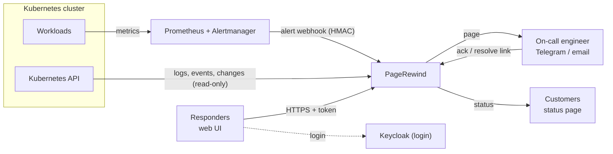
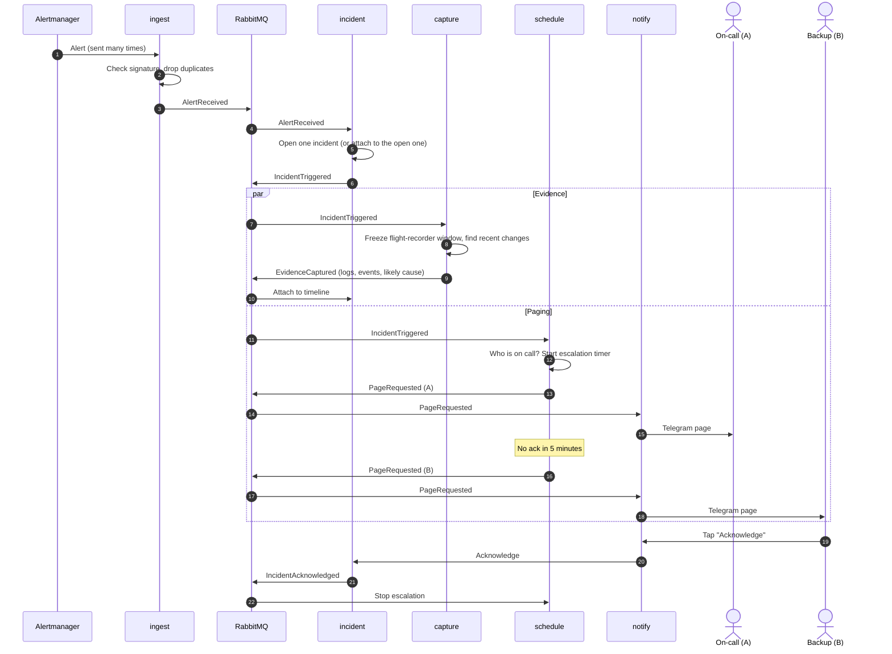
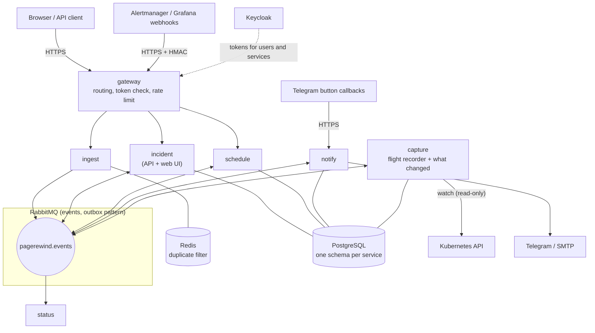
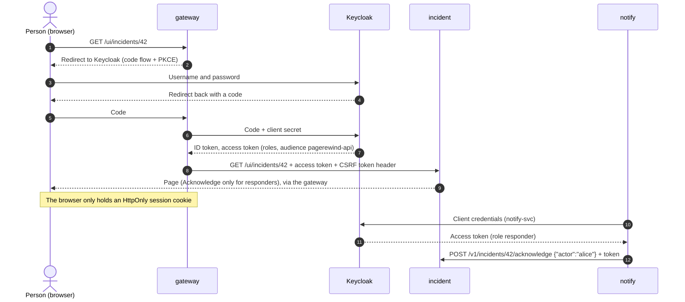
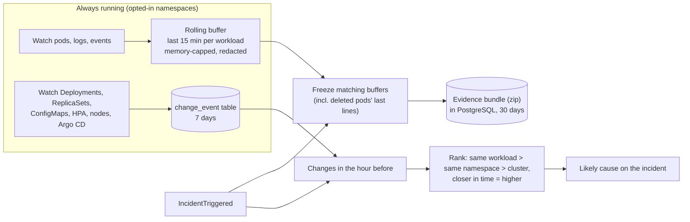
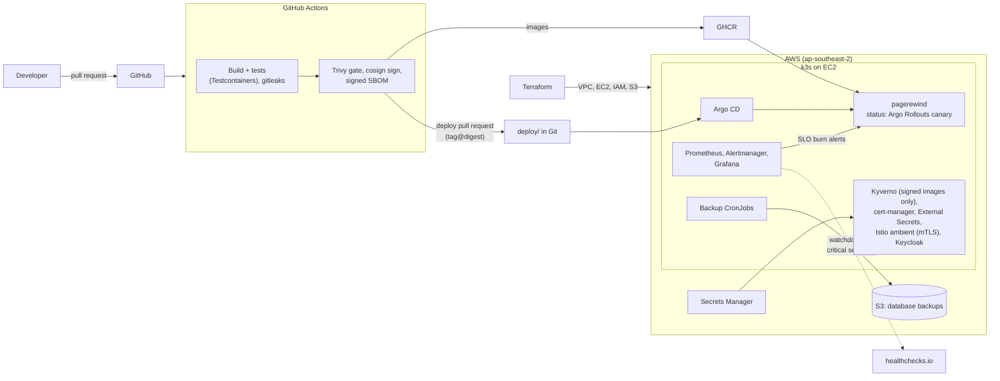

# Architecture

Status: matches v0.2.0 (24 Nov 2026). Parts not built yet are marked as planned.

PageRewind has two parts:

1. **The product:** the PageRewind services that users install (Docker Compose or Helm). No cloud
   provider is required.
2. **The reference deployment:** how the project itself is built, tested, deployed and monitored on
   AWS. Users do not need it; it lives in `infra/`, `platform/` and `deploy/pagerewind/`.

## 1. Big picture

Who talks to PageRewind, and why.

## 2. Alert journey

What happens from the moment something breaks.

## 3. Inside PageRewind

The services, how they talk, and where data lives.

Key rules:

- **No lost or doubled events:** each service writes its change and an outbox row in one database
  transaction; a publisher sends outbox rows to RabbitMQ. Consumers record each event id and skip
  repeats.
- **One incident per problem:** a unique database index on open incidents per fingerprint is the real
  guarantee; Redis is only a fast first filter.
- **Timers survive restarts:** escalation steps are stored in PostgreSQL, not in memory.
- **Least privilege:** `capture` can only read pods, logs, events and workload objects; it cannot
  exec into pods or read secrets.

### Logins and tokens (built in Day 4, see ADR 0009)

| Caller | How it proves who it is | What it may do |
|---|---|---|
| Person in the browser | Keycloak login, session at the gateway | By role: viewer reads, responder acts on incidents, admin changes schedules |
| Script or CI | `pagerewind-automation` token (client credentials) | admin |
| `notify` | `notify-svc` token (client credentials) | responder, recorded as the person who was paged |
| Alertmanager | Bearer token or HMAC signature at `ingest` | Send alerts (rate-limited at the gateway) |
| Telegram, email links | Telegram secret header, signed single-use links | Acknowledge or resolve one incident |

## 4. Flight recorder and "what changed"

Ranking also reads each container's image history in time order, so a revert, a rollback and the
re-deploy of an image that was rolled back earlier are scored differently. Planned, not built: Kubernetes
events and previous-container logs in the bundle, a metrics snapshot, evidence in S3.

## 5. Reference deployment (platform)

How the project is built and run. This is the DevOps side of the project.

- **GitOps:** Git holds what should run; Argo CD makes the cluster match.
- **Supply chain:** every image is scanned, signed keylessly and carries a signed SBOM; Kyverno lets only
  images signed by this repository's CI run; deploys pin images by digest.
- **Canary releases:** a new `status` version gets one of two pods; Prometheus checks its error rate and
  Argo Rollouts rolls back automatically above 5%.
- **Monitors itself:** SLO burn-rate alerts and processing-failure alerts go to PageRewind; critical
  ones also to healthchecks.io, which emails without depending on PageRewind; an always-firing
  Watchdog makes healthchecks.io email if alerting goes silent.
- **Backups:** pg_dump to S3 every 6 hours (the cluster cannot delete them); a weekly restore test.
- Planned, not built: preview environments per pull request, logs and traces (Loki, Tempo).

Runbooks and drill write-ups: see the [documentation index](index.md#where-to-go-next).
