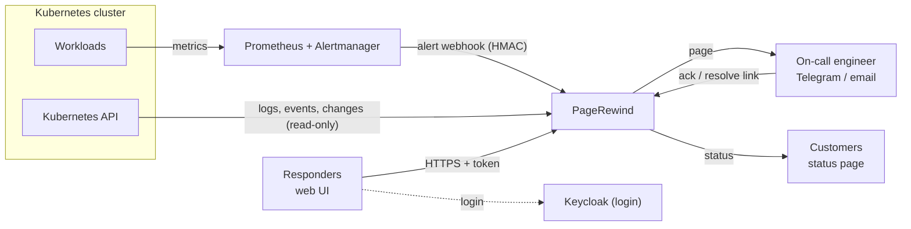
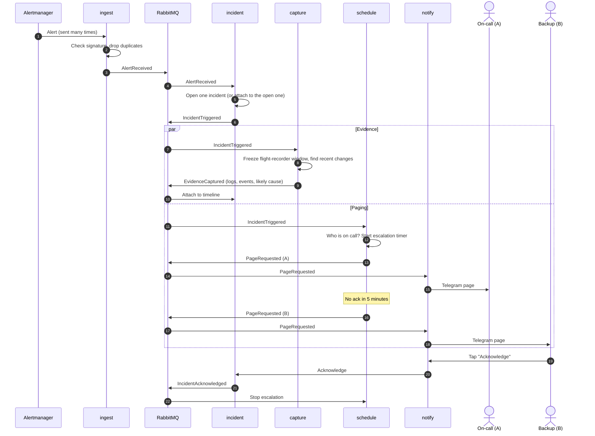
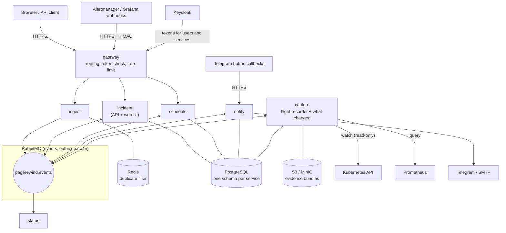
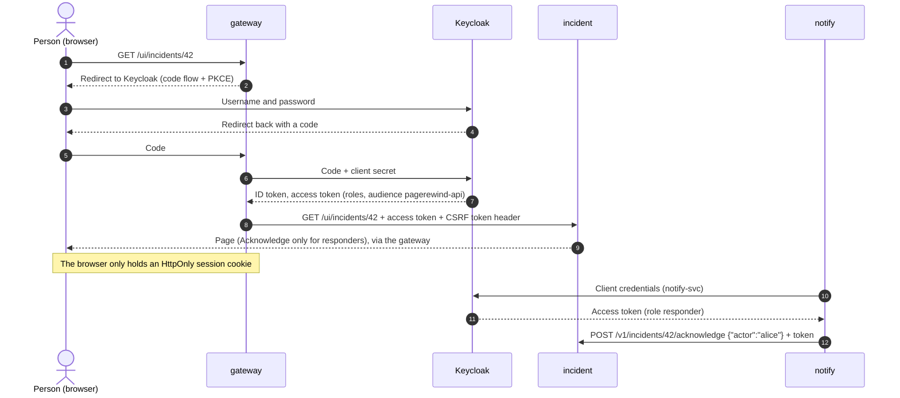
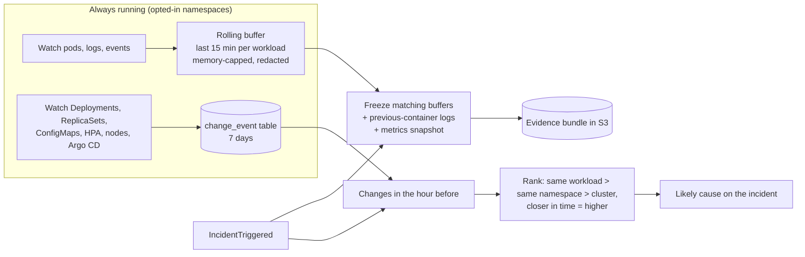
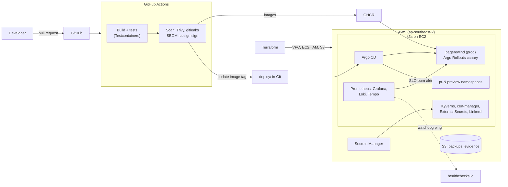

# Architecture

Status: planned. This page describes the design; it is updated as each part is built.

PageRewind has two parts:

1. **The product:** the PageRewind services that users install (Docker Compose or Helm). No cloud
   provider is required.
2. **The reference deployment:** how the project itself is built, tested, deployed and monitored on
   AWS. Users do not need it; it lives in `deploy/reference/`.

## 1. Big picture

Who talks to PageRewind, and why.

## 2. Alert journey

What happens from the moment something breaks.

## 3. Inside PageRewind

The services, how they talk, and where data lives.

Key rules:

- **No lost or doubled events:** each service writes its change and an outbox row in one database
  transaction; a publisher sends outbox rows to RabbitMQ. Consumers record each event id and skip
  repeats.
- **One incident per problem:** a unique database index on open incidents per fingerprint is the real
  guarantee; Redis is only a fast first filter.
- **Timers survive restarts:** escalation steps are stored in PostgreSQL, not in memory.
- **Least privilege:** `capture` can only read pods, logs, events and workload objects; it cannot
  exec into pods or read secrets.

### Logins and tokens (built in Day 4, see ADR 0009)

| Caller | How it proves who it is | What it may do |
|---|---|---|
| Person in the browser | Keycloak login, session at the gateway | By role: viewer reads, responder acts on incidents, admin changes schedules |
| Script or CI | `pagerewind-automation` token (client credentials) | admin |
| `notify` | `notify-svc` token (client credentials) | responder, recorded as the person who was paged |
| Alertmanager | Bearer token or HMAC signature at `ingest` | Send alerts (rate-limited at the gateway) |
| Telegram, email links | Telegram secret header, signed single-use links | Acknowledge or resolve one incident |

## 4. Flight recorder and "what changed"

## 5. Reference deployment (platform)

How the project is built and run. This is the DevOps side of the project.

- **GitOps:** Git holds what should run; Argo CD makes the cluster match.
- **Preview environments:** every pull request gets its own namespace and database.
- **Canary releases:** a new version gets 10% of traffic first; if errors or latency rise, Argo
  Rollouts rolls back automatically.
- **Monitors itself:** PageRewind's own SLO alerts are sent to PageRewind; an external watchdog
  emails if the whole system goes silent.
